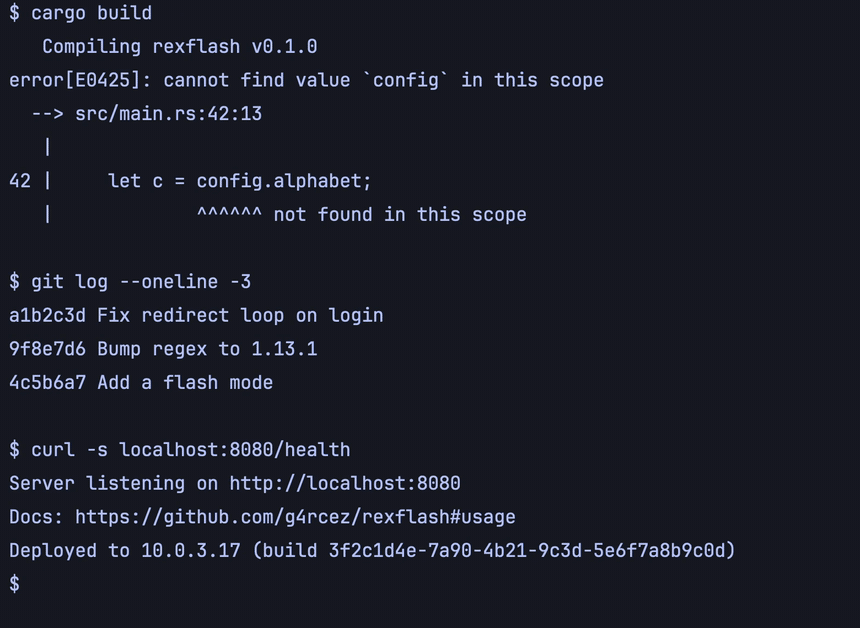

# rexflash

Keyboard-driven hints and flash search for [Rex](https://www.superlogical.com/rex/docs) terminal panes.

Press a key and every URL, path, git hash, IP address and more in the focused pane gets a short
label. Press the label to copy it, paste it at your prompt, or open it. No mouse, no copy mode.



It is a port of the ideas in [tmux-fingers](https://github.com/Morantron/tmux-fingers) (hints) and
[flash.nvim](https://github.com/folke/flash.nvim) (search labels) to Rex.

- **Hint mode** labels what looks like something you want to grab: URLs, `file:line` references,
  paths, hashes, IPs, UUIDs, emails, versions and more.
- **Flash mode** labels whatever you type. Type `loc`, then press the label next to the match.
- **Three ways to pick.** Lowercase label: copy. Uppercase (Shift): paste into the pane. Ctrl: open.
  All three are configurable, and a pick is always copied first.
- **Scrollback.** The overlay captures 2000 rows of history by default. Page Up and Page Down scroll it.
- **Safe by design.** Text from the screen never reaches a shell string. It goes to a command as stdin
  or as one argument.

## Requirements

- macOS (rexflash uses `pbcopy` and `open`)
- [Rex](https://www.superlogical.com/rex/docs)

## Install

### Homebrew

```sh
brew install g4rcez/tap/rexflash
```

This installs the `rexflash` binary and the Rex extension file
`/opt/homebrew/opt/rexflash/share/rexflash/rexflash.lua` (use `/usr/local/opt/...` on an Intel Mac).

### From source

```sh
cargo install --git https://github.com/g4rcez/rexflash
```

Then download [`rexflash.lua`](rexflash.lua) next to your `init.lua` and set `bin` to the path of the
installed binary (see [Options](#options)).

### From a release

Download the archive for your Mac from the
[releases page](https://github.com/g4rcez/rexflash/releases). It holds the binary and `rexflash.lua`.

## Set up

Add this to your Rex `init.lua`:

```lua
dofile("/opt/homebrew/opt/rexflash/share/rexflash/rexflash.lua") {
    hint_key = "ctrl+p>y",
    flash_key = "ctrl+p>/",
}
```

Rex defines two actions, `rexflash_hint` and `rexflash_flash`. They show in the action list even
without keys. `hint_key` and `flash_key` bind them. Press the same key again, or Esc, to close the overlay.

## Use

**Hint mode**

| Key               | What it does                                      |
| ----------------- | ------------------------------------------------- |
| a label           | Copy the match (`main_action`)                    |
| Shift + a label   | Copy it and paste it into the pane (`shift_action`) |
| Ctrl + a label    | Copy it and open it (`ctrl_action`)               |
| Alt + a label     | Copy it, then run `alt_action` (none by default)  |
| `q`, Esc, Ctrl-C  | Close                                             |

Labels have one or two letters. The matches you are most likely to want get the shortest labels, and
the same text always gets the same label.

**Flash mode**

Type a query. Matching is literal, and ignores case unless the query has an uppercase letter. Each match
gets a label just after it. A label is never the next letter of the text, so the next key is either a
label or a longer query. Pick a label with the same modifiers as above. Enter picks the match when only
one is left. Backspace edits the query.

**Scrolling**

Page Up, Page Down, Up, Down, Home and End move through the captured history. Only the matches on
screen get labels. Rex does not report where you scrolled the pane, so the view always starts at the
live screen.

**Open**

`:open:` runs macOS `open` on the match. For `src/main.rs:42:5` it opens `src/main.rs`. `~/` is
expanded, and relative paths resolve against the working directory of the pane.

## Patterns

By default hint mode looks for all of these except `digit`:

| Name         | Matches                                          |
| ------------ | ------------------------------------------------ |
| `url`        | `http`, `https`, `ftp`, `ssh`, `git` and `file` URLs, and `git@host:path` |
| `file-line`  | `src/main.rs:42:5`                               |
| `path`       | `/abs/path`, `./rel`, `~/home`, `dir/file.ext`   |
| `sha`        | Git hashes, 7 to 64 hex characters               |
| `ip`         | IPv4 address, with an optional port              |
| `ipv6`       | IPv6 address                                     |
| `uuid`       | UUIDs                                            |
| `email`      | Email addresses                                  |
| `hex`        | `0x1f4a`                                         |
| `color`      | `#fff`, `#1a1b26`                                |
| `semver`     | `v1.2.3`, `1.13.1`                               |
| `diff`       | Paths in `diff --git` and `---`/`+++` lines      |
| `git-status` | Paths in `git status` output                     |
| `digit`      | Numbers of 4 or more digits (off by default)     |

When matches overlap, the more specific pattern wins: a URL beats the path inside it, and `file-line` beats `path`. A match that wraps
over two rows counts as one match.

## Options

Pass them in the table you give to the function. A key that rexflash does not know is an error that
shows in the overlay when you use it.

```lua
dofile("/opt/homebrew/opt/rexflash/share/rexflash/rexflash.lua") {
    hint_key = "ctrl+p>y",
    flash_key = "ctrl+p>/",

    main_action = ":copy:",           -- label
    shift_action = ":paste:",         -- Shift + label
    ctrl_action = ":open:",           -- Ctrl + label
    alt_action = "",                  -- Alt + label

    patterns = { "url", "path", "sha" },
    extra = { "ticket (?P<match>[A-Z]+-\\d+)" },

    alphabet = "asdfghjkl",
    hint_position = "left",           -- or "right"
    hint_style = "1;38;5;0;48;5;12",  -- SGR codes
    highlight_style = "1;38;5;12",
    dim = false,
    scrollback = 2000,                -- rows above the screen, 0 to 50000

    bin = "/path/to/rexflash",        -- default: the Homebrew binary
    theme = { foreground = "#c0caf5", background = "#1a1b26" }, -- theme of the overlay
}
```

| Option                                          | Default                       | Meaning |
| ----------------------------------------------- | ----------------------------- | ------- |
| `hint_key`, `flash_key`                         | none                          | Rex key sequences that start each mode |
| `main_action`, `shift_action`, `ctrl_action`, `alt_action` | `:copy:`, `:paste:`, `:open:`, empty | What a pick does. See below |
| `patterns`                                      | all but `digit`               | Built-in patterns to use, by name |
| `extra`                                         | none                          | Your own regexes. A `(?P<match>...)` group limits what is copied |
| `alphabet`                                      | `asdfghjklwertyuiopzxvbnm`    | Label letters, most important first. Use at least 2 distinct letters a–z |
| `hint_position`                                 | `left`                        | Which end of a match gets its label |
| `hint_style`, `highlight_style`                 | blue                          | SGR parameters (digits, `;` and `:` only) |
| `dim`                                           | `false`                       | Dim the text that is not a match |
| `scrollback`                                    | `2000`                        | Rows of history to capture |
| `bin`                                           | Homebrew binary               | Path to the `rexflash` binary |
| `theme`                                         | Rex default                   | Theme of the overlay terminal |

An action is one of:

- `":copy:"` or `""`: copy only.
- `":paste:"`: copy, then type the match into the pane.
- `":open:"`: copy, then `open` it.
- Any other string: a shell command. It gets the match on stdin and the environment variables
  `MODIFIER` (`main`, `shift`, `ctrl` or `alt`) and `HINT` (the label). For example
  `alt_action = "xargs -I{} code {}"` opens the match in an editor.

## How it works

1. The Lua extension starts the `rexflash` binary in a floating terminal over the focused pane.
2. The binary asks Rex for the pane text with `rex capture` and for its size with `rex block call`.
3. It finds matches, draws the capture with labels, and reads the keys itself.
4. After a pick it runs the action, closes, and focuses the pane again. A paste uses `rex block call write`.

The pane is never drawn on. The `rex` command is found through `REX_BIN`, then `PATH`, then
`REX_BIN_DIR`, then the Rex app bundle in your home directory.

Rex draws a title bar and a border on every floating terminal, so the overlay is a little smaller than
the pane.

## Develop

```sh
cargo test
cargo clippy --all-targets
```

To use a local build, point `bin` at `target/release/rexflash`. See [docs/RELEASING.md](docs/RELEASING.md)
for how a release is made.

## License

[MIT](LICENSE)
